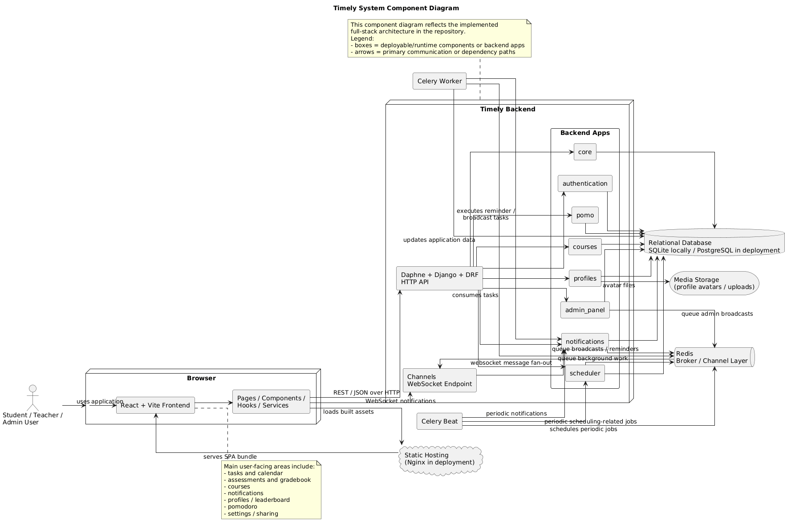

# Timely

Timely is a time management platform for higher education students. It combines task planning, calendar management, assessments, grades, notifications, sharing, and focus tools in one system so users can organise academic work more effectively.

The project is designed to go beyond a basic to-do list by supporting automated scheduling, recurring events, real-time notifications, collaborative sharing features, teacher-managed courses, and analytics-oriented views for student progress.

Production deployment: [timely.subhan.work](https://timely.subhan.work/)

## Team name: It Worked On My Machine

Members:
- David Dudun
- Harkaran (Mark) Bual
- Mahdi Mustafa Razzaque
- Mohammed Al-Amin
- Muhammad Subhan Afzal
- Patrick Sebastian Beckwith
- Rashid Bin Shehzad
- Thomas Richard Yale
- Tommy Hoang
- Valentino Garcia-Pianovszky

## Key Features

Academic planning and scheduling
- task creation, categorisation, recurrence, and deadline tracking
- automated scheduling with user-configurable working hours and category limits
- manual rescheduling and unscheduling flows for task planning

Calendar and event management
- unified month, week, day, and agenda calendar views
- one-off and recurring personal events
- recurring-event override support for editing individual instances
- import and export of calendar data

Course and teaching tools
- teacher registration and course management
- course events that sync into enrolled students' calendars
- join-code based course enrolment
- assessments and gradebook tracking linked to courses

Collaboration and social features
- friend system and sharing flows
- shared events and progress views
- leaderboard and weekly comparative statistics

Notifications and admin tooling
- in-app notifications and push-notification support
- broadcast notifications for admin users
- asynchronous background processing with Celery and Redis

Focus, analytics, and personalisation
- Pomodoro timer
- weekly statistics dashboard and analytics views
- theme, font, timezone, and profile settings

Event Export and Import
- event data can be converted into a file in the standard iCalendar format
- iCalendar files can be imported, and have event data created from them

Privacy and Data Deletion
- data can be deleted from the application, including user accounts, events and tasks

## Architecture

Timely uses a modular full-stack architecture:

- frontend: React 19, TypeScript, Vite, Tailwind CSS
- backend: Django 5, Django REST Framework, Knox authentication
- async and realtime: Django Channels, Redis, Celery worker, Celery beat
- data layer: SQLite for local development and PostgreSQL for deployment
- deployment: Nginx-based static hosting for the frontend and ASGI/Daphne for the backend stack

Design priorities:

- separation of concerns between UI, API, and scheduling logic
- testable backend apps split by domain (`core`, `courses`, `notifications`, `profiles`, `scheduler`, `pomo`)
- explicit API routing under `/api/`
- support for both simple local development and a fuller async notification stack

High-level system diagram:



## Design Goals

Timely aims to provide:

- a single place for students to manage deadlines, tasks, and timetable information
- clear separation between user-facing workflows and backend business logic
- support for both individual productivity and collaborative academic features
- a platform that is testable, maintainable, and deployable as a real web application

## Quick Start

The recommended path is the Nix flake because it installs dependencies, prepares a local SQLite database, generates local VAPID keys, and exposes consistent entrypoints.

```bash
nix run .#init
nix run .#run
```
You will then be able to access it from `http://localhost`

- Test suite: `nix run .#tests`
- Seed database only: `nix run .#seed`
- Remove seeded data: `nix run .#unseed`

If Nix is not available on your machine, use the manual Python + npm setup instead.


## Alternative local setup: Python + npm

Use this path if Nix is unavailable. The Nix path above is the least error-prone option because it sets the required local environment values automatically.

#### Prerequisites

- Python 3.12
- Node 20
- npm
- Redis if you want to run WebSockets, Celery, and scheduled notification flows locally

#### Backend setup

From the repository root:

```bash
python -m venv venv
source venv/bin/activate
pip install -r backend/requirements.txt
cp backend/.env.example backend/.env
```

Windows PowerShell equivalents:

```powershell
python -m venv venv
.\venv\Scripts\Activate.ps1
pip install -r backend/requirements.txt
Copy-Item backend/.env.example backend/.env
```

The example environment file is at [backend/.env.example](/D:/Coding/KCL/It-Worked-On-My-Machine/backend/.env.example). Before running migrations, edit `backend/.env` and set at minimum:

- `POSTGRES=False`
- `SECRET_KEY` to any non-empty local development value
- `REDIS_URL=redis://localhost:6379/0`

If you want push notifications locally, also generate VAPID keys and populate:

- `VAPID_PUBLIC_KEY`
- `VAPID_PRIVATE_KEY`
- `VAPID_ADMIN_EMAIL`

Then run:

```bash
python backend/manage.py migrate
```

#### Frontend setup

```bash
cd frontend
npm install
```

#### Running the Application

Backend:

```bash
source venv/bin/activate
python backend/manage.py runserver
```

Frontend:

```bash
cd frontend
npm run dev
```

Manual local URLs:

- Frontend: `http://localhost:5173`
- Backend API: `http://localhost:8000/api/`

#### Running tests

Backend tests:
```bash
cd backend
python manage.py test
```
Frontend tests:
```bash
cd frontend
npm run test
```

### External libraries and services

This project depends on external libraries and frameworks including:

- React, React Router, TypeScript, Vite, Tailwind CSS
- Axios, Headless UI, Heroicons, Recharts, React Big Calendar, React DnD, Three.js
- Django, Django REST Framework, django-cors-headers, django-filter
- Django Channels, channels-redis, Celery, Redis
- django-rest-knox for token authentication
- drf-spectacular for API schema support
- Faker, factory-boy, coverage, Vitest, Testing Library, ESLint, Ruff

These packages are listed in `frontend/package.json` and `backend/requirements.txt`.

All third-party libraries used by Timely are declared in:

- `frontend/package.json`
- `backend/requirements.txt`

Primary external services and infrastructure used by the project:

- PostgreSQL for deployed relational data storage
- Redis for Channels and Celery
- Celery worker and Celery beat for asynchronous and scheduled jobs
- Web Push / VAPID for browser push notifications

## AI Usage Disclosure

We have used tools like ChatGPT and Github Copilot for:
- understanding Django patterns and APIs
- guidance on how to implement common functionality
- debugging and error explanation
- generating migrations from the source code
- pull request reviewing

All the pull requests in which GitHub Copilot was used to review/generate code:
[#320](https://github.com/xlightningstar/It-Worked-On-My-Machine/pull/320)
[#309](https://github.com/xlightningstar/It-Worked-On-My-Machine/pull/309)
[#288](https://github.com/xlightningstar/It-Worked-On-My-Machine/pull/288)
[#286](https://github.com/xlightningstar/It-Worked-On-My-Machine/pull/286)
[#280](https://github.com/xlightningstar/It-Worked-On-My-Machine/pull/280)
[#271](https://github.com/xlightningstar/It-Worked-On-My-Machine/pull/271)
[#255](https://github.com/xlightningstar/It-Worked-On-My-Machine/pull/255)
[#176](https://github.com/xlightningstar/It-Worked-On-My-Machine/pull/176)
[#174](https://github.com/xlightningstar/It-Worked-On-My-Machine/pull/174)
[#156](https://github.com/xlightningstar/It-Worked-On-My-Machine/pull/156)
[#150](https://github.com/xlightningstar/It-Worked-On-My-Machine/pull/150)
[#164](https://github.com/xlightningstar/It-Worked-On-My-Machine/pull/164)
[#155](https://github.com/xlightningstar/It-Worked-On-My-Machine/pull/155)
[#154](https://github.com/xlightningstar/It-Worked-On-My-Machine/pull/154)
[#149](https://github.com/xlightningstar/It-Worked-On-My-Machine/pull/149)
[#145](https://github.com/xlightningstar/It-Worked-On-My-Machine/pull/145)
[#140](https://github.com/xlightningstar/It-Worked-On-My-Machine/pull/140)
[#133](https://github.com/xlightningstar/It-Worked-On-My-Machine/pull/133)
[#104](https://github.com/xlightningstar/It-Worked-On-My-Machine/pull/104)
[#71](https://github.com/xlightningstar/It-Worked-On-My-Machine/pull/71)
[#87](https://github.com/xlightningstar/It-Worked-On-My-Machine/pull/87)
[#69](https://github.com/xlightningstar/It-Worked-On-My-Machine/pull/69)
[#65](https://github.com/xlightningstar/It-Worked-On-My-Machine/pull/65)
[#64](https://github.com/xlightningstar/It-Worked-On-My-Machine/pull/64)
[#62](https://github.com/xlightningstar/It-Worked-On-My-Machine/pull/62)
[#48](https://github.com/xlightningstar/It-Worked-On-My-Machine/pull/48)
[#53](https://github.com/xlightningstar/It-Worked-On-My-Machine/pull/53)
[#45](https://github.com/xlightningstar/It-Worked-On-My-Machine/pull/45)
[#40](https://github.com/xlightningstar/It-Worked-On-My-Machine/pull/40)
[#37](https://github.com/xlightningstar/It-Worked-On-My-Machine/pull/37)
[#25](https://github.com/xlightningstar/It-Worked-On-My-Machine/pull/25)


## Limitations and Future Work

- Push notifications require valid VAPID keys and a compatible browser environment.
- Courses and Notifications do not work using Nix or local setup, it only works using Docker
- The complete iCalendar specification is not implemented, meaning that imported files with certain unsupported (by the application) syntax will fail to be parsed. Currently, this results in no changes being made. Future development would certainly require an expansion of the iCakendar specification supported so that more valid files can be imported.
