# 03 — Architecture

> **Related docs:** [Overview →](./01-overview.md) | [Data Model →](./04-data-model.md) | [Notifications →](./08-notifications.md) | [Scheduler →](./07-scheduler.md)

---

## System Overview

Timely is structured as two independent deployable units — a Django backend serving a REST API and WebSocket connections, and a React SPA served by Nginx — communicating over HTTP and WebSocket through a single reverse proxy.



### Request path (HTTP)

```
Browser → Cloudflare (IP filter) → Nginx → Django Daphne (ASGI)
                                        ↘ Static files (served directly by Nginx)
```

### Request path (WebSocket)

```
Browser → Cloudflare → Nginx (ws:// upgrade) → Django Channels → Redis (channel layer)
```

---

## Backend — Django Project Structure

The Django project is named **`source`** (not `backend`). All settings, URL routing, ASGI configuration, and Celery initialisation live in `backend/source/`.

```
backend/
├── source/
│   ├── settings.py       # All configuration (DB, Redis, Celery, Knox, CORS…)
│   ├── urls.py           # Root URL dispatcher
│   ├── asgi.py           # ASGI entrypoint (HTTP + WebSocket routing)
│   └── celery.py         # Celery app + beat schedule
├── core/                 # Primary domain app
├── authentication/       # Auth app
├── scheduler/            # Scheduling engine
├── notifications/        # Notification delivery
├── profiles/             # User profiles
├── admin_panel/          # Admin features
├── courses/              # Course management
└── pomo/                 # Pomodoro sessions
```

---

## Django Application Responsibilities

### `core`
The central domain app. Contains all primary models (Tasks, Events, Categories, Assessments, Grades, Friendships, Preferences, SpecialDates), their serializers, views, and business logic services. Also contains management commands (`seed`, `unseed`) and the user timezone middleware.

### `authentication`
Implements Knox token-based authentication with a custom `User` model. Handles registration, login, logout, and logout-all-devices endpoints.

### `scheduler`
A custom time-slot allocation engine that runs synchronously on demand. Given a user's tasks, calendar events, and preferences, it computes optimal time blocks and writes the result to `Task.allocation` (a JSONField). Contains no models of its own. See [Scheduler →](./07-scheduler.md) for algorithmic detail.

### `notifications`
Multi-channel notification delivery. Manages:
- Real-time WebSocket push via Django Channels
- Browser push notifications via VAPID/Web Push
- Event reminder dispatch (Celery Beat every 60 s)
- Admin broadcast jobs with delivery audit logging
- Periodic maintenance (Celery Beat daily at 03:00)

### `profiles`
User-facing profile data (name, bio, avatar, slogan) and the gamification layer (XP, level). XP is awarded via a post-save signal on `Task`. Also serves the public leaderboard.

### `admin_panel`
Superuser-only broadcast and user management. Delegates notification delivery to `notifications` app Celery tasks. Exposes audience counts, broadcast history, and retry-failed-sends endpoints.

### `courses`
Course entity lifecycle: teacher creation, join-code-based student enrolment, course event management, staff assignment, and permissions. A Celery Beat task (`sync_cal`, every 5 minutes) propagates course events to enrolled students' calendars via the `sync_cal` management command.

### `pomo`
Minimal Pomodoro session tracker. Logs completed focus-session durations against the authenticated user.

---

## URL Routing

The root URL dispatcher in `backend/source/urls.py` mounts all sub-routes under `/api/`:

| URL prefix | App / View |
|---|---|
| `/api/authentication/` | `authentication.urls` |
| `/api/profiles/` | `profiles.urls` |
| `/api/pomo/` | `pomo.urls` |
| `/api/admin/` | `admin_panel.urls` |
| `/api/notifications/` | `notifications.urls` (notifications + push) |
| `/api/tasks/` | `core` — `TaskViewSet` |
| `/api/events/` | `core` — `EventViewSet` |
| `/api/categories/` | `core` — `CategoryViewSet` |
| `/api/assessments/` | `core` — `AssessmentViewSet` |
| `/api/grades/` | `core` — `GradeViewSet` |
| `/api/preferences/` | `core` — `PreferenceViewSet` |
| `/api/friendships/` | `core` — `FriendshipViewSet` |
| `/api/special-dates/` | `core` — `SpecialDatesViewSet` |
| `/api/schedule/` | `scheduler` — `ScheduleTasksAPIView` |
| `/api/unschedule/` | `scheduler` — `UnscheduleTasksAPIView` |
| `/api/stats/weekly/` | `core` — `WeeklySummaryView` |
| `/api/export/` | `core` — `ExportView` |
| `/api/import/` | `core` — `ImportView` |
| `/api/share_send/` | `core` — `ShareSendView` |
| `/api/share_accept/` | `core` — `ShareAcceptView` |
| `/api/share_events/` | `core` — `ShareEventsView` |
| `/api/delete_events/` | `core` — `DeleteAllEventsView` |
| `/api/delete_tasks/` | `core` — `DeleteAllTasksView` |
| `/api/delete_account/` | `core` — `DeleteAccountView` |
| `/api/courses/` | `courses.urls` |
| `/api/teachers/` | `courses.urls` |

WebSocket routing (in `backend/source/asgi.py`):

| WebSocket path | Consumer |
|---|---|
| `ws/notifications/` | `notifications.consumers.NotificationConsumer` |

---

## Authentication

Timely uses **Knox token authentication** (not JWT).

### Flow

1. Client sends `POST /api/authentication/register/` or `POST /api/authentication/session/` (login) with credentials.
2. Server returns an opaque Knox token.
3. Client stores the token in `localStorage`.
4. Every subsequent request includes `Authorization: Token <token>` (attached by the Axios interceptor in `frontend/src/services/api.ts`).
5. `POST /api/authentication/logout/` destroys the current token server-side.
6. `POST /api/authentication/logoutall/` destroys all tokens for the user.

### Token TTL

Tokens expire after **24 hours** (configured via `REST_KNOX.TOKEN_TTL` in `settings.py`).

### Custom User model

`authentication.User` extends `AbstractBaseUser` and `PermissionsMixin`. Fields: `username`, `email`, `date_of_birth`, `is_active`, `is_staff`, `is_superuser`, `date_joined`. `AUTH_USER_MODEL = "authentication.User"`.

---

## Middleware Stack

Applied in order (innermost first in the Django middleware chain):

| Middleware | Purpose |
|---|---|
| `CorsMiddleware` | CORS headers for frontend origin |
| `SecurityMiddleware` | HTTPS redirect, HSTS |
| `WhiteNoiseMiddleware` | Serves static files |
| `SessionMiddleware` | Session support (used by Django admin) |
| `CommonMiddleware` | URL normalisation |
| `CSRFViewMiddleware` | CSRF protection |
| `AuthenticationMiddleware` | Attaches `request.user` |
| `UserTimezoneMiddleware` (custom) | Activates the authenticated user's preferred timezone for each request |
| `MessageMiddleware` | Flash messages |
| `XFrameOptionsMiddleware` | Clickjacking protection |

---

## Celery Architecture

Celery is used **exclusively for notification delivery** — not for the scheduling algorithm.

### Workers and beat tasks

| Component | Description |
|---|---|
| `celery-worker` | Processes queued notification tasks |
| `celery-beat` | Dispatches periodic tasks on schedule |

### Periodic task schedule

| Task | Schedule | Description |
|---|---|---|
| `check_reminders` | Every 60 seconds | Queries unprocessed `EventReminder` records; dispatches push/WebSocket alerts |
| `cleanup_old_notifications` | Daily at 03:00 | Deletes stale notifications and dispatch logs |
| `sync_course_calendar` | Every 5 minutes | Runs `sync_cal` management command to propagate course events |

---

## Key Design Patterns

### Model splitting (core app)
The `core` app uses one file per model in `core/models/`, all imported via `core/models/__init__.py`. Other apps use a single `models.py`.

### Queryset scoping
All viewsets scope their querysets to `request.user`. No cross-user data leakage is possible at the ORM layer.

### Business logic in services
Complex business logic (e.g., event expansion, calendar validation) lives in `core/services/` rather than in views.

### Atomic transactions
Multi-model write operations use `django.db.transaction.atomic()` to ensure consistency.

### Timezone handling
All datetimes are stored in UTC. The `UserTimezoneMiddleware` activates the user's preferred timezone for the duration of each request, so `timezone.localdate()` and `timezone.now()` return correctly localised values within the scheduler engine.
