# 04 — Data Model

> **Related docs:** [Architecture →](./03-architecture.md) | [API Reference →](./05-api-reference.md)

---

## Entity Relationship Diagram

---

## Model Reference

### `authentication.User`

Custom user model (`AUTH_USER_MODEL = "authentication.User"`). Extends `AbstractBaseUser` and `PermissionsMixin`.

| Field | Type | Constraints | Notes |
|-------|------|-------------|-------|
| `id` | AutoField (PK) | — | — |
| `username` | CharField | unique | Login identifier |
| `email` | EmailField | unique | — |
| `date_of_birth` | DateField | null, blank | Optional |
| `is_active` | BooleanField | default `True` | — |
| `is_staff` | BooleanField | default `False` | Django admin access |
| `is_superuser` | BooleanField | default `False` | Full permissions |
| `date_joined` | DateTimeField | auto_now_add | — |

`USERNAME_FIELD = "username"`, `REQUIRED_FIELDS = ["email"]`

---

### `profiles.Profile`

One-to-one extension of `User` with display and gamification data.

| Field | Type | Constraints | Notes |
|-------|------|-------------|-------|
| `id` | AutoField (PK) | — | — |
| `user` | OneToOneField → `User` | on_delete CASCADE | — |
| `name` | CharField | — | Display name |
| `date_of_birth` | DateField | null, blank | — |
| `creation_date` | DateTimeField | auto_now_add | — |
| `slogan` | CharField | blank | Short tagline |
| `bio` | TextField | blank | — |
| `avatar` | ImageField | null, blank | Profile picture |
| `xp` | PositiveBigIntegerField | default 0 | Experience points |
| `level` | PositiveBigIntegerField | default 1 | Level-ups every 300 XP |

---

### `core.Preference`

One-to-one scheduling preferences for a user.

| Field | Type | Constraints | Notes |
|-------|------|-------------|-------|
| `user` | OneToOneField → `User` | on_delete CASCADE | — |
| `day_start` | TimeField | — | Start of working day |
| `day_end` | TimeField | — | End of working day |
| `day_schedule` | JSONField | — | Per-day overrides (start/end times) |
| `days_off` | ManyToManyField → `DayOfWeek` | blank | Days scheduler skips |
| `max_hours_study_per_day` | PositiveSmallIntegerField | — | Daily study cap (hours) |
| `max_days_ahead` | PositiveSmallIntegerField | — | Scheduling horizon (days) |
| `drag_snap_minutes` | PositiveSmallIntegerField | — | Calendar drag resolution |
| `limit_max_hours` | BooleanField | — | Enforce daily hour cap |
| `disable_sound_effects` | BooleanField | — | — |
| `default_landing_page` | CharField | choices | Page shown after login |
| `week_starts_on` | CharField | choices (`Mon`/`Sun`) | — |
| `time_format` | CharField | choices (`12h`/`24h`) | — |
| `timezone` | CharField | — | IANA timezone string |

---

### `core.Category`

User-defined label for tasks and events.

| Field | Type | Constraints | Notes |
|-------|------|-------------|-------|
| `id` | AutoField (PK) | — | — |
| `user` | ForeignKey → `User` | null, blank, on_delete SET_NULL | null = system category |
| `text` | CharField | — | Display label |
| `colour` | CharField | null, blank | Hex colour string |
| `colour_override` | BooleanField | default `False` | Override task/event colour |
| `max_daily_study_time` | PositiveSmallIntegerField | null, blank | Scheduler limit (minutes/day) |

---

### `core.Task`

The central schedulable work item.

| Field | Type | Constraints | Notes |
|-------|------|-------------|-------|
| `id` | AutoField (PK) | — | — |
| `user` | ForeignKey → `User` | on_delete CASCADE | — |
| `title` | CharField | — | — |
| `description` | TextField | blank | — |
| `categories` | ManyToManyField → `Category` | blank | — |
| `colour` | CharField | null, blank | Hex colour |
| `estimated_minutes` | PositiveIntegerField | — | Total planned effort |
| `completed_minutes` | PositiveIntegerField | default 0 | Progress logged |
| `start_time` | DateTimeField | — | Earliest scheduling start |
| `deadline` | DateTimeField | — | Must complete by |
| `completed` | BooleanField | default `False` | — |
| `locked` | BooleanField | default `False` | Exclude from rescheduling |
| `allow_split` | BooleanField | default `False` | Permit multi-block allocation |
| `min_split_minutes` | PositiveSmallIntegerField | — | Minimum block size |
| `max_split_minutes` | PositiveSmallIntegerField | null, blank | Maximum block size |
| `buffer_before_minutes` | PositiveSmallIntegerField | default 0 | Gap before task block |
| `buffer_after_minutes` | PositiveSmallIntegerField | default 0 | Gap after task block |
| `parent_task` | ForeignKey → self | null, blank | For split sub-tasks |
| `total_task_allocations` | PositiveIntegerField | default 0 | Count of scheduled blocks |
| `allocation` | JSONField | default list | Scheduler output (segments) |
| `importance` | PositiveSmallIntegerField | choices 1–10 | Scheduling priority |

**Computed property:** `remaining_minutes = estimated_minutes − completed_minutes`

---

### `core.Event`

A calendar event, inheriting from `BaseEventModel`.

| Field | Type | Constraints | Notes |
|-------|------|-------------|-------|
| `id` | AutoField (PK) | — | — |
| `user` | ForeignKey → `User` | on_delete CASCADE | — |
| `title` | CharField | — | From `BaseEventModel` |
| `description` | TextField | blank | From `BaseEventModel` |
| `location` | CharField | blank | From `BaseEventModel` |
| `colour` | CharField | null, blank | From `BaseEventModel` |
| `start_time` | DateTimeField | — | From `BaseEventModel` |
| `end_time` | DateTimeField | — | From `BaseEventModel` |
| `last_edited` | DateTimeField | — | From `BaseEventModel` |
| `categories` | ManyToManyField → `Category` | blank | — |
| `recurrence_interval` | CharField | null, blank, choices | `daily`/`weekly`/`monthly`/`yearly` |
| `recurrence_end` | DateField | null, blank | End of recurrence series |
| `exception_dates` | JSONField | default list | Dates to skip in recurrence |
| `split_from_event` | ForeignKey → self | null, blank | Source of a split series |

---

### `core.EventReminder`

A scheduled reminder for an event occurrence.

| Field | Type | Constraints | Notes |
|-------|------|-------------|-------|
| `id` | AutoField (PK) | — | — |
| `event` | ForeignKey → `Event` | on_delete CASCADE | — |
| `send_email` | BooleanField | — | Send email reminder |
| `send_push` | BooleanField | — | Send push notification |
| `minutes_before` | PositiveIntegerField | — | Lead time |
| `trigger_at` | DateTimeField | editable=False | Computed on save |
| `processed` | BooleanField | default `False` | Set after dispatch |

---

### `core.EventOverride`

Stores mutations to a single occurrence of a recurring event without altering the series.

| Field | Type | Constraints | Notes |
|-------|------|-------------|-------|
| `id` | AutoField (PK) | — | — |
| `parent_event` | ForeignKey → `Event` | on_delete CASCADE | — |
| `original_start_time` | DateTimeField | — | Which occurrence is overridden |
| `categories` | ManyToManyField → `Category` | blank | — |
| `reminders_snapshot` | JSONField | — | Reminder config for this occurrence |

**Constraint:** unique per `(parent_event, original_start_time)`.

---

### `core.Assessment`

An academic assessment linked optionally to a calendar event.

| Field | Type | Constraints | Notes |
|-------|------|-------------|-------|
| `id` | AutoField (PK) | — | — |
| `user` | ForeignKey → `User` | on_delete CASCADE | — |
| `title` | CharField | — | — |
| `assessment_type` | CharField | choices | e.g. `exam`, `coursework` |
| `due_date` | DateTimeField | — | — |
| `length_of_assessment` | PositiveIntegerField | null, blank | Duration (minutes) |
| `weighting_of_assessment` | PositiveIntegerField | — | Percentage weight |
| `notes` | TextField | blank | — |
| `reminder_offset` | PositiveIntegerField | null, blank | Minutes before due date |
| `linked_event` | OneToOneField → `Event` | null, blank | Auto-created/synced event |
| `assessment_category` | ForeignKey → `Category` | null, blank | Category for the assessment |
| `module_category` | ForeignKey → `Category` | null, blank | Module/subject category |
| `categories` | ManyToManyField → `Category` | blank | — |
| `completed` | BooleanField | default `False` | — |
| `created_at` | DateTimeField | auto_now_add | — |
| `updated_at` | DateTimeField | auto_now | — |

**Meta:** `ordering = ["due_date"]`

---

### `core.Grade`

A recorded grade result for an assessment or subject.

| Field | Type | Constraints | Notes |
|-------|------|-------------|-------|
| `id` | AutoField (PK) | — | — |
| `user` | ForeignKey → `User` | on_delete CASCADE | — |
| `name` | CharField | — | Grade label |
| `category` | ForeignKey → `Category` | null, blank | Subject/module |
| `score` | FloatField | — | Achieved score |
| `total_possible` | FloatField | — | Maximum possible score |
| `date_achieved` | DateField | — | — |

**Computed property:** `percentage = (score / total_possible) * 100`

---

### `core.Friendship`

A directional friend request with state tracking.

| Field | Type | Constraints | Notes |
|-------|------|-------------|-------|
| `id` | AutoField (PK) | — | — |
| `sender` | ForeignKey → `User` | on_delete CASCADE | Who sent the request |
| `receiver` | ForeignKey → `User` | on_delete CASCADE | Who received it |
| `state` | CharField | choices | `sent` / `accepted` / `declined` |
| `updated_at` | DateTimeField | null, blank | Last state change |

**Constraint:** unique per `(sender, receiver)` pair.

---

### `core.PendingShareEvent`

An in-flight event-share request between two users.

| Field | Type | Constraints | Notes |
|-------|------|-------------|-------|
| `id` | AutoField (PK) | — | — |
| `sender` | ForeignKey → `User` | on_delete CASCADE | — |
| `receiver` | ForeignKey → `User` | on_delete CASCADE | — |
| `event` | ForeignKey → `Event` | on_delete CASCADE | — |

**Constraint:** unique per `(sender, receiver, event)`.

---

### `core.SpecialDates`

User-defined notable dates (e.g., holidays, personal milestones).

| Field | Type | Constraints | Notes |
|-------|------|-------------|-------|
| `id` | AutoField (PK) | — | — |
| `user` | ForeignKey → `User` | on_delete CASCADE | — |
| `date` | DateField | — | — |
| `text` | CharField | blank | Label |

---

### `core.ReminderDispatchLog`

Prevents duplicate reminder dispatches for recurring event occurrences.

| Field | Type | Constraints | Notes |
|-------|------|-------------|-------|
| `id` | AutoField (PK) | — | — |
| `source_event` | ForeignKey → `Event` | on_delete CASCADE | — |
| `original_start_time` | DateTimeField | — | Occurrence start |
| `reminder_signature` | CharField | — | Hash of reminder config |
| `dispatched_at` | DateTimeField | auto_now_add | — |

---

### `notifications.Notification`

An in-app notification record.

| Field | Type | Constraints | Notes |
|-------|------|-------------|-------|
| `id` | AutoField (PK) | — | — |
| `recipient` | ForeignKey → `User` | on_delete CASCADE | — |
| `sender` | ForeignKey → `User` | null, blank | System notifications have no sender |
| `title` | CharField | — | — |
| `message` | TextField | — | — |
| `is_read` | BooleanField | default `False` | — |
| `timestamp` | DateTimeField | auto_now_add | — |
| `notification_type` | CharField | choices | `system` / `task` / `calendar` |

**Meta:** `ordering = ["-timestamp"]`, `db_table = "core_notification"`

---

### `notifications.PushSubscription`

Stores Web Push subscription credentials for a user's browser.

| Field | Type | Constraints | Notes |
|-------|------|-------------|-------|
| `id` | AutoField (PK) | — | — |
| `user` | ForeignKey → `User` | on_delete CASCADE | — |
| `endpoint` | URLField | — | Push service endpoint |
| `p256dh` | CharField | — | Public key for encryption |
| `auth` | CharField | — | Auth secret |
| `created_at` | DateTimeField | auto_now_add | — |

**Constraint:** unique per `(user, endpoint)`. `db_table = "core_pushsubscription"`

---

### `notifications.BroadcastJob`

Tracks an admin broadcast notification campaign.

| Field | Type | Constraints | Notes |
|-------|------|-------------|-------|
| `id` | AutoField (PK) | — | — |
| `sender` | ForeignKey → `User` | null, blank | Admin who sent it |
| `title` | CharField | — | — |
| `message` | CharField | — | — |
| `target` | CharField | choices | `all` / `staff` / `admin` / `users` / `retry_failed` |
| `audience_filters` | JSONField | — | Applied filters |
| `audience_snapshot` | JSONField | — | Resolved recipient list at send time |
| `recipient_count` | PositiveIntegerField | — | — |
| `delivered_count` | PositiveIntegerField | — | — |
| `failed_count` | PositiveIntegerField | — | — |
| `status` | CharField | choices | `queued` / `in_progress` / `completed` / `partial` / `failed` |
| `task_id` | CharField | — | Celery task ID |
| `provider_errors` | JSONField | — | Push delivery errors |
| `queued_at` | DateTimeField | auto_now_add | — |
| `started_at` | DateTimeField | null | — |
| `completed_at` | DateTimeField | null | — |
| `retry_of` | ForeignKey → self | null, blank | If this is a retry |

---

### `notifications.BroadcastRecipient`

Per-user delivery record within a broadcast campaign.

| Field | Type | Constraints | Notes |
|-------|------|-------------|-------|
| `broadcast_job` | ForeignKey → `BroadcastJob` | on_delete CASCADE | — |
| `recipient` | ForeignKey → `User` | on_delete CASCADE | — |
| `notification` | ForeignKey → `Notification` | null | Created notification |
| `status` | CharField | choices | `pending` / `sent` / `failed` |
| `error_code` | CharField | blank | — |
| `error_message` | TextField | blank | — |
| `last_attempt_at` | DateTimeField | null | — |

**Constraint:** unique per `(broadcast_job, recipient)`.

---

### `notifications.BroadcastAuditLog`

Immutable audit trail for broadcast actions.

| Field | Type | Constraints | Notes |
|-------|------|-------------|-------|
| `broadcast_job` | ForeignKey → `BroadcastJob` | on_delete CASCADE | — |
| `actor` | ForeignKey → `User` | null | Admin who performed the action |
| `action` | CharField | choices | `send` / `retry` |
| `audience_snapshot` | JSONField | — | Audience at time of action |
| `payload` | JSONField | — | Full request payload |
| `created_at` | DateTimeField | auto_now_add | — |

---

### `pomo.PomoSession`

A completed Pomodoro focus session.

| Field | Type | Constraints | Notes |
|-------|------|-------------|-------|
| `id` | AutoField (PK) | — | — |
| `user` | ForeignKey → `User` | on_delete CASCADE | — |
| `duration_minutes` | PositiveIntegerField | — | — |
| `completed_at` | DateTimeField | auto_now_add | — |

---

### Courses App Models

#### `courses.Course`

| Field | Type | Constraints | Notes |
|-------|------|-------------|-------|
| `id` | AutoField (PK) | — | — |
| `name` | CharField | — | — |
| `description` | TextField | blank | — |
| `lead_teacher` | ForeignKey → `Teacher` | — | — |
| `active` | BooleanField | default `True` | — |

#### `courses.Teacher`

| Field | Type | Constraints | Notes |
|-------|------|-------------|-------|
| `id` | AutoField (PK) | — | — |
| `user` | OneToOneField → `User` | — | — |
| `active` | BooleanField | default `True` | — |

#### `courses.Student`

| Field | Type | Constraints | Notes |
|-------|------|-------------|-------|
| `id` | AutoField (PK) | — | — |
| `user` | OneToOneField → `User` | — | — |

#### `courses.CourseEnrollment`

Junction table linking a `Student` to a `Course`.

#### `courses.CourseEvent`

An event created by a teacher within a course; propagated to enrolled students' calendars.

#### `courses.CourseStaff`

Links a user as course staff with permission flags.

#### `courses.CourseJoinCode`

One-time or reusable join code for a course.
