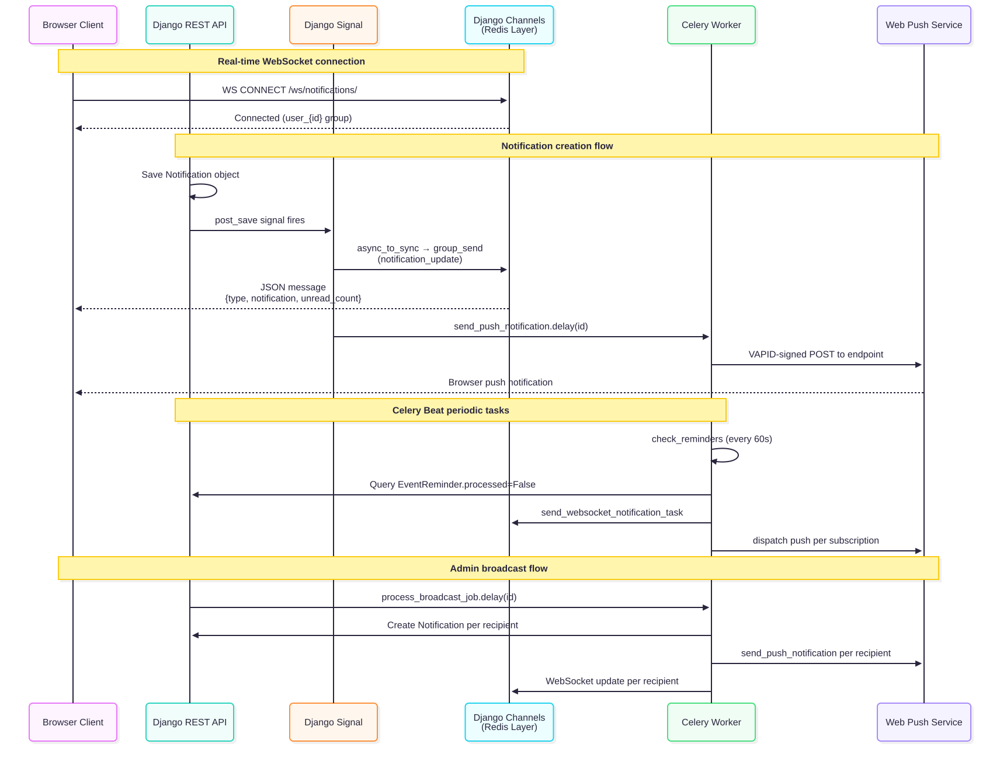

# 08 — Notifications

> **Related docs:** [Architecture →](./03-architecture.md) | [API Reference →](./05-api-reference.md#notifications) | [Deployment →](./10-deployment.md)

---

## Overview

Timely delivers notifications through three complementary channels:

| Channel | Technology | Use case |
|---------|-----------|---------|
| **WebSocket** | Django Channels + Redis | Real-time in-app alerts |
| **Web Push** | VAPID / pywebpush | Browser notifications when tab is closed or backgrounded |
| **Celery tasks** | Celery Beat + Redis | Scheduled reminders, broadcast delivery, maintenance |

All three channels are coordinated by the `notifications` Django app (`backend/notifications/`).

---

## Real-time WebSocket Notifications



### Connection

The frontend establishes a persistent WebSocket connection on authentication:

```
ws://host/ws/notifications/
```

In production, Nginx upgrades the connection and proxies it to the Uvicorn ASGI server.

### Consumer

`NotificationConsumer` (`backend/notifications/consumers/notification_consumer.py`) is an `AsyncWebsocketConsumer` that:

1. On connect: authenticates the user and joins the user-specific group `user_{user_id}`.
2. On disconnect: leaves the group.
3. On `notification_update` group event: serialises the notification and sends a JSON message to the client.

### Message format

```json
{
  "type": "notification_update",
  "notification": {
    "id": 42,
    "title": "Reminder: Essay due tomorrow",
    "message": "Your event 'Essay Submission' is tomorrow at 14:00.",
    "is_read": false,
    "timestamp": "2026-01-14T10:30:00Z",
    "notification_type": "calendar"
  },
  "unread_count": 5
}
```

### Signal integration

`backend/notifications/signals/notification_signal.py` registers a `post_save` handler on the `Notification` model. When a `Notification` is created:

1. A WebSocket message is dispatched to the recipient's group via `async_to_sync(channel_layer.group_send)`.
2. A Celery task `send_push_notification.delay(notification_id)` is queued.

This keeps notification creation and delivery fully decoupled.

---

## Web Push Notifications

### Setup requirements

Web Push requires VAPID keys configured in `backend/.env`:

```dotenv
VAPID_PUBLIC_KEY=<base64-encoded-public-key>
VAPID_PRIVATE_KEY=<base64-encoded-private-key>
VAPID_ADMIN_EMAIL=mailto:admin@example.com
```

Push notifications are silently disabled if these keys are absent — the `PushSubscriptionViewSet` returns `503` on `vapid_public_key`.

### Subscription lifecycle

1. Frontend calls `GET /api/push/vapid_public_key/` to obtain the public key.
2. Browser registers a push subscription via the Web Push API using the VAPID public key.
3. Frontend sends `POST /api/push/subscribe/` with `{ endpoint, p256dh, auth }`.
4. Subscriptions are stored in `PushSubscription` (unique per `user + endpoint`).
5. On unsubscribe: `POST /api/push/unsubscribe/` with `{ endpoint }`.

### Delivery

`send_push_notification` Celery task (`backend/notifications/tasks/push.py`):

1. Loads the `Notification` by ID.
2. Fetches all `PushSubscription` records for the recipient.
3. Sends a VAPID-signed POST to each push endpoint using `pywebpush`.
4. Removes expired subscriptions (HTTP 410 Gone response from push service).

---

## Event Reminders

Reminders are driven by `EventReminder` model records created alongside calendar events.

### Reminder model

Each `EventReminder` stores:
- `event` — the parent event
- `minutes_before` — lead time
- `trigger_at` — computed datetime (set on save as `event.start_time − minutes_before`)
- `send_email` / `send_push` — delivery channel flags
- `processed` — set `True` after dispatch to prevent re-delivery

### Celery Beat task

`check_reminders` runs **every 60 seconds**:

1. Queries `EventReminder` records where `trigger_at <= now()` and `processed = False`.
2. For recurring events, uses `ReminderDispatchLog` to deduplicate — a reminder is only dispatched once per `(source_event, original_start_time, reminder_signature)` combination.
3. Creates a `Notification` per user (which triggers the signal pipeline above).
4. Marks the reminder `processed = True`.

---

## Admin Broadcast System

Administrators can send notifications to large audiences via the broadcast API.

### Broadcast lifecycle

```
POST /api/admin/send_notification/
  → Creates BroadcastJob (status: queued)
  → Queues process_broadcast_job.delay(job_id)
  → Returns { broadcast_id, message: "Queued" }

process_broadcast_job (Celery worker)
  → Sets status: in_progress
  → Resolves recipient list from target + audience_filters
  → Creates BroadcastRecipient per user (status: pending)
  → For each recipient:
      → Creates Notification
      → Queues send_push_notification
      → Updates BroadcastRecipient status: sent / failed
  → Sets status: completed / partial / failed
  → Records BroadcastAuditLog entry
```

### Broadcast targets

| Target | Recipients |
|--------|-----------|
| `all` | All active users |
| `staff` | Users with `is_staff = True` |
| `admin` | Users with `is_superuser = True` |
| `users` | Specific user IDs provided in `user_ids` |
| `retry_failed` | Recipients from a previous broadcast with `status: failed` |

### Retry

`POST /api/admin/broadcasts/{broadcastId}/retry_failed/` creates a new `BroadcastJob` with `retry_of` pointing to the original, targeting only failed recipients.

---

## Maintenance Tasks

`cleanup_old_notifications` runs daily at **03:00 UTC** (Celery Beat):

- Deletes `Notification` records older than a configured retention period.
- Deletes processed `ReminderDispatchLog` entries older than retention period.

This prevents unbounded growth of the notifications table.

---

## Notification Model Reference

See [Data Model → Notifications](./04-data-model.md#notificationsnotification) for field definitions of:
- `Notification`
- `PushSubscription`
- `BroadcastJob`
- `BroadcastRecipient`
- `BroadcastAuditLog`

---

## Frontend Integration

The `NotificationContext` (`src/context/NotificationContext.tsx`) maintains the current unread count. The `useWebSocket` hook (`src/hooks/common/useWebSocket.ts`) manages the WebSocket connection lifecycle.

On receiving a `notification_update` message:
1. `NotificationContext` increments the unread count.
2. `NotificationBell` component re-renders the badge.
3. If the notifications page is open, the list refreshes.

The `usePushSubscription` hook (`src/hooks/notifications/usePushSubscription.ts`) handles subscription registration via the Service Worker API on first login.

---

## Channel Layer Configuration

In production, Django Channels uses Redis as the channel layer:

```python
CHANNEL_LAYERS = {
    "default": {
        "BACKEND": "channels_redis.core.RedisChannelLayer",
        "CONFIG": {"hosts": [REDIS_URL]},
    }
}
```

In the test environment, `InMemoryChannelLayer` is used (configured via `TEST_RUNNER` settings), avoiding Redis as a test dependency.
