# 10 — Deployment

> **Related docs:** [Installation →](./02-installation.md) | [Architecture →](./03-architecture.md) | [Notifications →](./08-notifications.md)

---

## Overview

Timely is deployed on **DigitalOcean** using Docker Compose. The CI/CD pipeline is fully automated: a push to `main` builds container images, pushes them to DigitalOcean Container Registry (DOCR), and deploys via SSH.



---

## Infrastructure

| Component | Technology | Notes |
|-----------|-----------|-------|
| Cloud provider | DigitalOcean Droplet | Any Ubuntu 22.04+ Droplet |
| Container registry | DigitalOcean Container Registry (DOCR) | `registry.digitalocean.com/{registry}/{image}` |
| Web server / reverse proxy | Nginx 1.27 (in frontend container) | TLS termination via Cloudflare |
| ASGI server | Daphne | Handles HTTP + WebSocket for backend |
| Database | PostgreSQL 16 | `postgres:16-alpine` container |
| Cache / broker | Redis 7 | `redis:7-alpine` container |
| Task queue | Celery (worker + beat) | Separate containers |

---

## Docker Compose — Production

`docker-compose.yml` defines the full production stack:

```
services:
  backend        → Daphne ASGI server (port 8000)
  celery-worker  → Celery worker
  celery-beat    → Celery beat scheduler
  redis          → Redis 7 Alpine
  frontend       → Nginx serving built React app
  postgres       → PostgreSQL 16 Alpine
```

### Service startup order

```
redis ← backend, celery-worker, celery-beat
postgres ← backend, celery-worker, celery-beat
backend ← (no other services depend on it)
```

### Volumes

| Volume | Purpose |
|--------|---------|
| `postgres_data` | Persistent PostgreSQL data |
| `static_volume` | Django `collectstatic` output |
| `media_volume` | User-uploaded files (profile avatars) |

---

## Dockerfiles

### Backend (`backend/Dockerfile`)

```
Base:      ghcr.io/astral-sh/uv:python3.12-alpine
Process:
  1. Copy requirements and install deps with uv pip
  2. Copy project source
  3. RUN python manage.py collectstatic --noinput
  4. EXPOSE 8000
  5. CMD: daphne -b 0.0.0.0 -p 8000 source.asgi:application
```

### Frontend (`frontend/Dockerfile`)

```
Stage 1 — builder:
  Base:  node:25-alpine3.22
  Steps: npm ci && npm run build

Stage 2 — runtime:
  Base:  nginx:1.27-alpine
  Steps: COPY --from=builder /app/dist /usr/share/nginx/html
         COPY nginx.conf /etc/nginx/conf.d/default.conf
  EXPOSE 80
```

---

## Nginx Configuration

Nginx serves the React SPA and proxies API/WebSocket requests to the backend.

```nginx
server {
    listen 80;

    # Cloudflare IP whitelist (production only)
    include /etc/nginx/cloudflare_ips.conf;

    # Static files — React SPA
    location / {
        root /usr/share/nginx/html;
        try_files $uri $uri/ /index.html;
    }

    # REST API
    location /api/ {
        proxy_pass http://backend:8000;
        proxy_set_header Host $host;
        proxy_set_header X-Real-IP $remote_addr;
    }

    # WebSocket
    location /ws/ {
        proxy_pass http://backend:8000;
        proxy_http_version 1.1;
        proxy_set_header Upgrade $http_upgrade;
        proxy_set_header Connection "upgrade";
    }

    # Django admin
    location /admin/ {
        proxy_pass http://backend:8000;
    }

    # Django static files
    location /static/ {
        proxy_pass http://backend:8000;
    }
}
```

The development Nginx config (`nginx.dev.conf`) is identical but omits the Cloudflare IP whitelist, allowing direct connections.

---

## Environment Variables

Sensitive configuration is passed via environment variables. Never commit `.env` files.

### Backend (`.env` in `backend/`)

| Variable | Required | Description |
|----------|----------|-------------|
| `SECRET_KEY` | ✅ | Django secret key |
| `DEBUG` | ✅ | `False` in production |
| `ALLOWED_HOSTS` | ✅ | Comma-separated hostnames |
| `DATABASE_URL` | ✅ | PostgreSQL connection string |
| `POSTGRES_DB` | ✅ | Database name |
| `POSTGRES_USER` | ✅ | Database user |
| `POSTGRES_PASSWORD` | ✅ | Database password |
| `POSTGRES_HOST` | ✅ | Database host (use `postgres` in Docker) |
| `POSTGRES_PORT` | — | Default `5432` |
| `REDIS_URL` | ✅ | Redis connection string (e.g. `redis://redis:6379/0`) |
| `CORS_ALLOWED_ORIGINS` | ✅ | Frontend origin(s) |
| `VAPID_PUBLIC_KEY` | — | Web Push VAPID public key |
| `VAPID_PRIVATE_KEY` | — | Web Push VAPID private key |
| `VAPID_ADMIN_EMAIL` | — | VAPID contact email |
| `ENABLE_RECURRENCE_OVERRIDES` | — | `True` to enable event instance overrides |

### Root `.env` (Docker Compose)

| Variable | Description |
|----------|-------------|
| `DOCR_REGISTRY` | DigitalOcean Container Registry name |
| `IMAGE_TAG` | Docker image tag (set by CI to the commit SHA) |
| `DROPLET_HOST` | Droplet IP address |
| `DROPLET_USER` | SSH user on the Droplet |

---

## CI/CD Pipeline

### `build.yml` — Production deployment

Triggered on: **push to `main`**.

```
Steps:
  1. Checkout
  2. Log in to DOCR
  3. Build backend image  →  registry.digitalocean.com/{registry}/backend:{sha}
  4. Push backend image
  5. Build frontend image →  registry.digitalocean.com/{registry}/frontend:{sha}
  6. Push frontend image
  7. SSH into Droplet:
       a. docker login DOCR
       b. docker compose pull
       c. docker compose up -d --no-build
       d. docker compose exec backend python manage.py migrate
       e. docker compose exec backend python manage.py collectstatic --noinput
```

### `test-backend.yml` — Backend CI

Triggered on: pull requests to `main`.

Runs: Ruff lint → Django tests → coverage ≥ 90 % → Docker build smoke test.

### `test-frontend.yml` — Frontend CI

Triggered on: pull requests to `main`.

Runs: ESLint → Vitest (coverage ≥ 60 %) → Docker build smoke test.

### `previews.yml` — PR preview environments

Triggered on: pull requests.

Spins up an ephemeral preview environment per PR, posts the URL as a PR comment. Preview is torn down when the PR is closed.

### `opencode.yml` — AI code review

Triggered on: PR comments containing `/oc` or `/opencode`.

Runs an OpenCode AI review on the pull request diff.

---

## Deploying for the First Time

### Prerequisites

1. A DigitalOcean Droplet with Docker and Docker Compose installed.
2. A DigitalOcean Container Registry created.
3. GitHub secrets configured (see below).
4. DNS pointing to the Droplet (or via Cloudflare proxy).

### GitHub secrets required

| Secret | Value |
|--------|-------|
| `DOCR_TOKEN` | DigitalOcean API token with registry write access |
| `DOCR_REGISTRY` | Registry name (e.g. `my-registry`) |
| `DROPLET_HOST` | Droplet IP |
| `DROPLET_USER` | SSH user (usually `root`) |
| `DROPLET_SSH_KEY` | Private key for SSH access |

### First-time database setup

After the first deployment:

```bash
# SSH into the Droplet
ssh user@droplet-ip

# Run initial migrations
docker compose exec backend python manage.py migrate

# Create a superuser
docker compose exec backend python manage.py createsuperuser

# (Optional) Seed with sample data
docker compose exec backend python manage.py seed
```

---

## Routine Operations

### Updating the application

Push to `main`. The `build.yml` workflow handles everything automatically.

### Rolling back

```bash
# SSH into Droplet
ssh user@droplet-ip

# Set a previous image tag
export IMAGE_TAG=<previous-commit-sha>

# Pull and restart
docker compose pull && docker compose up -d --no-build
```

### Viewing logs

```bash
# All services
docker compose logs -f

# Backend only
docker compose logs -f backend

# Celery worker
docker compose logs -f celery-worker
```

### Running management commands

```bash
docker compose exec backend python manage.py <command>

# Examples:
docker compose exec backend python manage.py shell
docker compose exec backend python manage.py dbshell
docker compose exec backend python manage.py migrate
docker compose exec backend python manage.py collectstatic --noinput
docker compose exec backend python manage.py seed
```

### Restarting individual services

```bash
docker compose restart backend
docker compose restart celery-worker
docker compose restart celery-beat
```

---

## TLS / HTTPS

TLS termination is handled by **Cloudflare** in front of the Nginx container. The Nginx config uses Cloudflare's IP ranges to enforce that only Cloudflare-proxied traffic reaches the Droplet (via the `cloudflare_ips.conf` include).

- No `certbot` or self-signed certs are required on the Droplet.
- Ensure the Cloudflare SSL/TLS mode is set to **Full (strict)** to prevent HTTP downgrade between Cloudflare and the origin.

---

## Health Checks

No explicit `HEALTHCHECK` is defined in the Dockerfiles. The deployment step runs `docker compose up -d --no-build`, which will restart any crashed containers.

For production monitoring, consider adding `HEALTHCHECK` directives and a Droplet monitoring alert in DigitalOcean.

---

## Dev Stack vs Production Stack

| Setting | Development | Production |
|---------|-------------|------------|
| Database | SQLite (file in `backend/`) | PostgreSQL 16 container |
| Static files | Django dev server | Nginx from `static_volume` |
| Hot reload | Bind-mounted volumes | Immutable container image |
| Cloudflare IPs | Not enforced | Enforced in Nginx |
| HTTPS | HTTP only (`localhost`) | Via Cloudflare |
| Celery | Optional | Always running |

See [Installation →](./02-installation.md) for running the dev stack locally.
